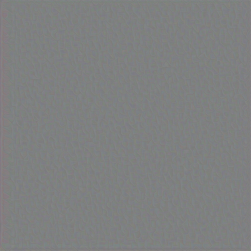
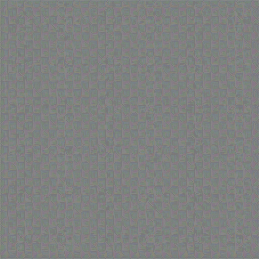
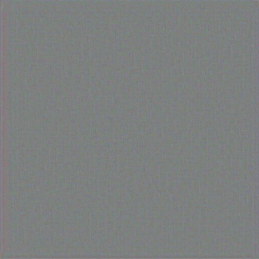
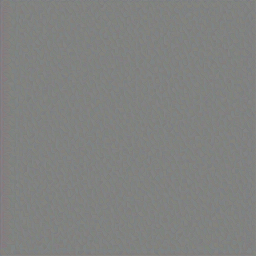
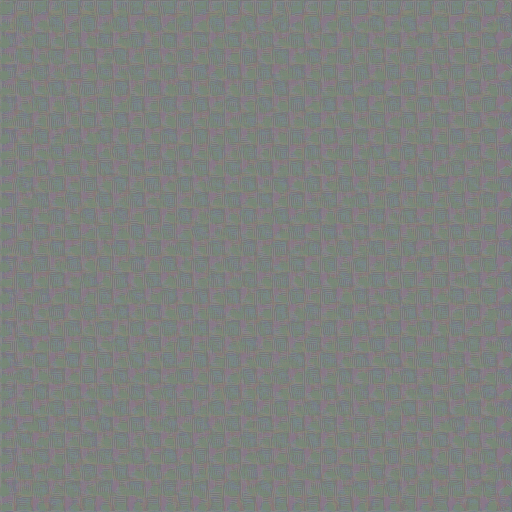
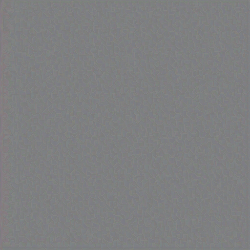
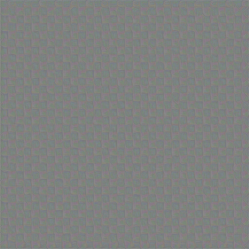
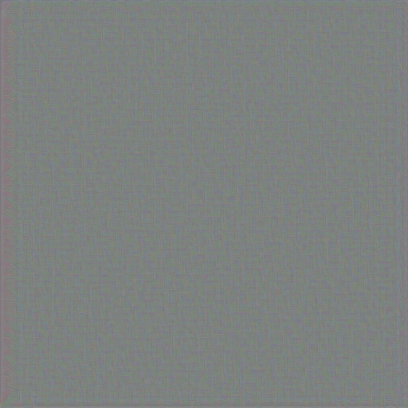

# AI Photo Shield Masks

Pre-computed Universal Adversarial Perturbation (UAP) masks for 100% client-side AI photo protection on hubtool.cc.

## Overview

`ai-photo-shield-masks` provides pre-computed perturbation masks designed to protect photos against unauthorized AI manipulation, face editing, and feature extraction models. By applying these noise masks client-side before image upload or distribution, images become resilient to AI-based synthesis and unauthorized edits.

## Available UAP Masks

Below is the complete list of 8 pre-computed UAP masks available in `uap_masks/`:

| # | Mask File | Description | Preview |
|---|---|---|---|
| 1 | `mask_01_portrait_soft.png` | Soft Portrait Mask |  |
| 2 | `mask_02_portrait_balanced.png` | Balanced Portrait Mask |  |
| 3 | `mask_03_vivid_outdoor.png` | Vivid Outdoor Mask |  |
| 4 | `mask_04_lowlight_dark.png` | Lowlight / Dark Scene Mask |  |
| 5 | `mask_05_high_detail.png` | High Detail Texture Mask |  |
| 6 | `mask_06_flat_pastel.png` | Flat / Pastel Color Mask |  |
| 7 | `mask_07_cool_tone.png` | Cool Tone Lighting Mask |  |
| 8 | `mask_08_general_universal.png` | General Universal Mask |  |

## jsDelivr CDN Usage

You can load these masks directly into web projects via jsDelivr CDN for repository `NDagarjat/ai-photo-shield-masks`:

`https:&#x2F;&#x2F;cdn.jsdelivr.net&#x2F;gh&#x2F;NDagarjat&#x2F;ai-photo-shield-masks@main&#x2F;uap_masks&#x2F;<mask_filename>`

## License & Credits

This project is licensed under the MIT License.

### Credits
MIT License credit and adversarial perturbation research attributed to MadryLab/photoguard.
.

## Overview

ai-photo-shield-masks provides pre-computed perturbation masks designed to protect photos against unauthorized AI manipulation, face editing, and feature extraction models. By applying these noise masks client-side before image upload or distribution, images become resilient to AI-based synthesis and unauthorized edits.

## Available UAP Masks

Below is the complete list of 8 pre-computed UAP masks available in uap_masks/:

| # | Mask File | Description | Preview |
|---|---|---|---|
| 1 | mask_01_portrait_soft.png | Soft Portrait Mask |  |
| 2 | mask_02_portrait_balanced.png | Balanced Portrait Mask |  |
| 3 | mask_03_vivid_outdoor.png | Vivid Outdoor Mask |  |
| 4 | mask_04_lowlight_dark.png | Lowlight / Dark Scene Mask |  |
| 5 | mask_05_high_detail.png | High Detail Texture Mask |  |
| 6 | mask_06_flat_pastel.png | Flat / Pastel Color Mask |  |
| 7 | mask_07_cool_tone.png | Cool Tone Lighting Mask |  |
| 8 | mask_08_general_universal.png | General Universal Mask |  |

## jsDelivr CDN Usage

You can load these masks directly into web projects via jsDelivr CDN for repository NDagarjat/ai-photo-shield-masks:

`https:&#x2F;&#x2F;cdn.jsdelivr.net&#x2F;gh&#x2F;NDagarjat&#x2F;ai-photo-shield-masks@main&#x2F;uap_masks&#x2F;<mask_filename>`

## License & Credits

This project is licensed under the MIT License.

### Credits
MIT License credit and adversarial perturbation research attributed to MadryLab/photoguard.
